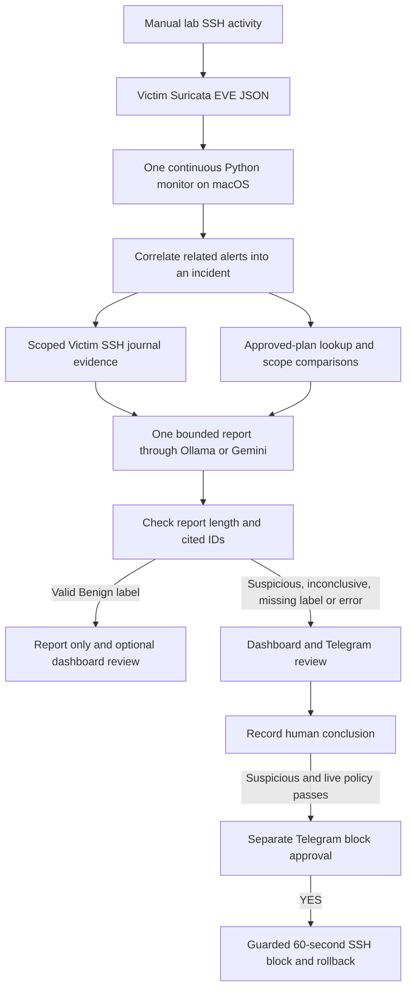
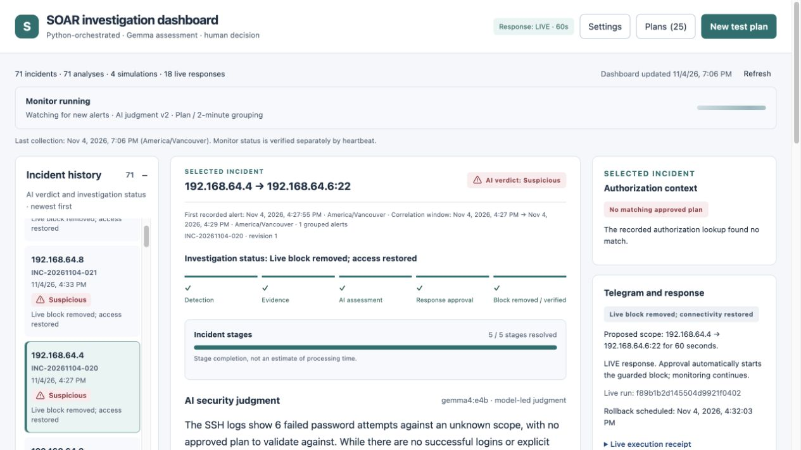
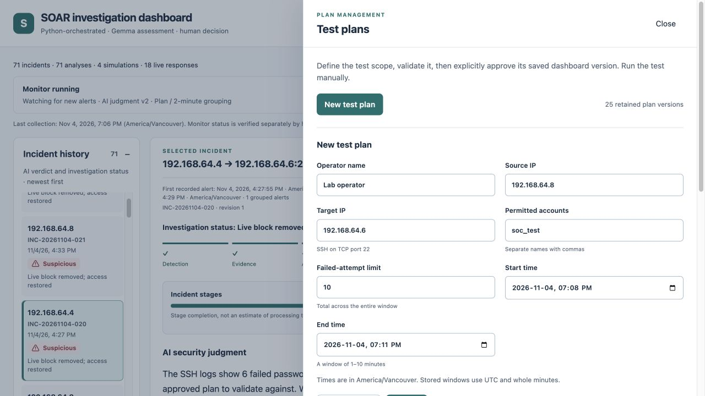
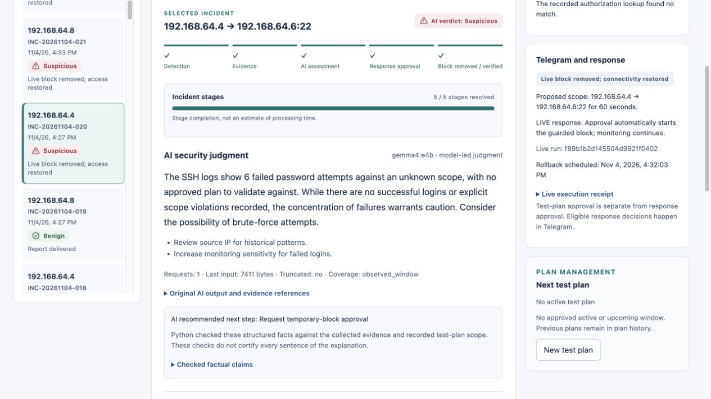
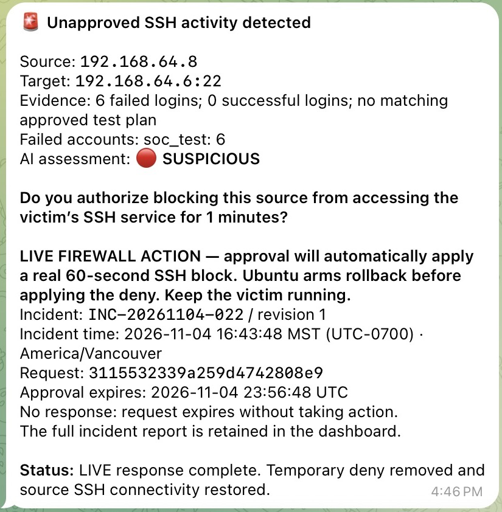
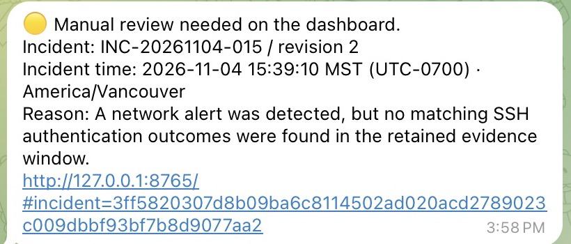
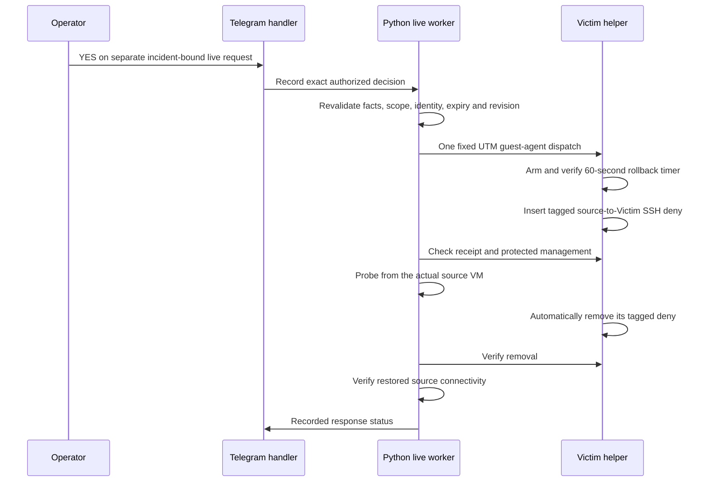

# macOS SSH Investigation and Response Lab

[](https://github.com/mashaojin/soar-investigation-macOS/actions/workflows/tests.yml)

**soar-investigation-macOS** is a macOS-focused, Python-led lab that turns **Suricata alerts into evidence-based investigations, dashboard records and human-approved responses**.

This is the original **Mac / UTM / Gemma4** implementation, previously named `soc-pipeline`. The separate [Windows project](https://github.com/mashaojin/soar-investigation-windows) has its own setup, platform adapters and verification limits. This README uses the same organization as that project, but all commands below describe this macOS implementation.

**Suricata → Python correlation and SSH evidence → one bounded AI advisory report → report only or operator review.**

Ollama with Gemma4 is the default. Google Gemini API is optional and requires separate local authorization before new incident evidence can be sent. Python collects evidence and checks the report's length and citation IDs. The operator records the final conclusion. This is an educational lab and runs without Hermes.

## Contents

- [Workflow and decision boundaries](#workflow)
- [Dashboard and Telegram screenshots](#screenshots)
- [macOS lab requirements](#macos-lab-requirements)
- [Quick start](#quick-start)
- [Dashboard features and settings](#dashboard-guide)
- [Configuration and credentials](#configuration-and-credentials)
- [Three manual scenarios](#three-manual-scenarios)
- [Telegram decisions and live response](#telegram-decisions)
- [Stop, restart and recovery](#stop-restart-and-recovery)
- [Verification and troubleshooting](#verification-status)
- [Documentation and repository layout](#documentation)

## Workflow



### Responsibilities

| Component | Responsibility | Cannot authorize |
| --- | --- | --- |
| Suricata | Detect connection-threshold activity and write EVE alerts | Password outcomes, malicious intent or a block |
| Python collector | Continuous ingestion, cursor handling and incident correlation | An AI verdict |
| Evidence/plan layer | Scoped authentication outcomes, coverage and authorization comparisons | A security classification |
| Selected AI model | Plain-text assessment, evidence citations and suggested next step | Operator conclusions or firewall changes |
| Python output checks | Bound the text to 4,096 UTF-8 bytes and verify cited IDs exist | Assess whether the reasoning is correct |
| Operator | Review evidence and record a conclusion in the dashboard or Telegram | Authorize a firewall change through a review button |

The model starts with a standalone plain-text line such as `Assessment: Benign`, `Assessment: Suspicious`, or `Assessment: Insufficient evidence`. Python uses the line for routing and keeps the length and citation checks. The model explains its judgment in prose.

| Assessment outcome | Dashboard | Telegram |
| --- | --- | --- |
| Benign | **Report only** with optional human review | Brief report without buttons |
| Suspicious | **Manual review required** | Review notice with **Benign**, **Suspicious**, and **Need more evidence** |
| Insufficient evidence, missing or unrecognized label, or assessment error | **Manual review required** | Review notice with the reason and the same review choices |

The operator can complete a requested review in either place. Review choices record a conclusion and cannot approve a firewall block. The new routing applies to future incident revisions. Existing assessments keep their recorded workflow state.

### What happens to one incident

1. You run a bounded SSH test manually. For approved activity, create and approve the plan **before its start**.
2. Suricata writes an alert to `/var/log/suricata/eve.json` on Victim.
3. The Mac monitor reads new EVE records over SSH, saves the cursor and groups related alerts. An incident receives a durable internal ID, readable number and revision.
4. Python waits for its evidence window to close, then reads the scoped `ssh.service` journal and the recorded test-plan authorization. Counts and scope comparisons are supplied as facts.
5. The selected model receives bounded evidence and writes a plain-text assessment. Python checks that the response fits within the length limit and that any cited IDs exist in the supplied evidence. There is no automatic retry.
6. The dashboard retains the report and original evidence. With Telegram enabled, the monitor sends a brief report for Benign or a review notice with incident-bound conclusion buttons for other outcomes.
7. When review is requested, record **Benign**, **Suspicious** or **Need more evidence** as a separate human conclusion.

**Evidence timing:** unapproved scopes use a fixed **120-second** correlation window, up to **60 seconds** of pre-alert context and a **30-second** arrival allowance. Approved scopes use the entire approved plan window plus the arrival allowance. Authorization boundaries can shorten an unapproved scope. Collection catch-up and inference add further delay. Related runs can become one incident; do not expect one incident for every invocation of the client script.

## Screenshots

These are actual screenshots from recorded Mac/UTM lab rehearsals. Different images show different incidents; they are not one continuous replay. The Telegram captures are cropped to the relevant messages.

### Dashboard



The dashboard preserves readable incident numbers, timestamps, grouped alerts, AI assessments, separate human conclusions and response progress. Monitor health is checked by heartbeat, separately from saved database state.

<details>
<summary>Test-plan editor and incident assessment</summary>



*An unsaved plan-editor example. Test-plan approval defines authorized activity; it does not approve a firewall response.*



*Recorded Gemma assessment and response example. Read the retained evidence and coverage limits alongside the model's explanation.*

</details>

### Telegram

| Live-response completion | Manual-review notice |
| --- | --- |
|  |  |

The live screenshot shows a completed historical response, so its pending approval buttons are no longer displayed. The historical structured-response workflow offered **YES — Approve LIVE 60s block** and **NO — Deny block / report only**. Current advisory review notices offer **Benign / Suspicious / Need more evidence**. See [screenshot provenance](docs/SCREENSHOTS.md).

## macOS lab requirements

| Component | Requirement |
| --- | --- |
| Host | macOS with UTM installed at `/Applications/UTM.app`, OpenSSH and Python 3.12+ |
| VM backend | QEMU-backed UTM Linux guests with working guest-agent execution and file transfer |
| Inference | Ollama on the Mac, reachable at `127.0.0.1:11434`, exact model `gemma4:e4b` |
| Model budgets | Configured context capacity 65,536 tokens; output cap 1,024 tokens; bounded requests and validation |
| Victim | Ubuntu, SSH, Suricata/EVE, readable SSH journal, UFW and systemd |
| Trust-Client | Ubuntu guest for approved tests and account-scope scenarios |
| Attacker | Kali guest for the controlled unapproved scenario |
| Network | One shared lab subnet with the exact identities below and working guest-to-guest and Mac-to-Victim access |
| Telegram | Your own bot and private chat/operator identity; exactly one poller |
| Capacity | Enough host memory for three guests and local inference; no universal hardware minimum is qualified by CI |

Python uses the standard library: there is no pip installation step. Node is used for development/CI syntax checks, not the Python dashboard. Offline tests also run on Linux. Choose guest images matching the Mac's architecture; the UTM installation and guest-network checkpoints are in the [full setup guide](docs/MACOS.md).

### Fixed lab identities

| Role | UTM VM name | Guest account | IPv4 address |
| --- | --- | --- | --- |
| Victim | `Victim` | `victim` | `192.168.64.6/24` |
| Attacker | `Kali Linux` | `kali` | `192.168.64.4/24` |
| Approved-test client | `Trust-Client` | `trust-client` | `192.168.64.8/24` |
| Management | Mac host on the lab network | Your Mac account | `192.168.64.1` |

The management source and Victim address are protected from response targeting. Confirm the Mac's actual SSH source as seen by Victim; do not assume every UTM installation uses these addresses. IPs, guest names, usernames and UTM transport assumptions appear in Python helpers as well as JSON. **Reproduce this exact topology or port the helpers and tests together; editing JSON alone does not retarget the lab.**

## Quick start

Follow these steps in order. **Mac** commands run in the repository root on the host; **Victim**, **Kali** and **Trust-Client** commands run in those VMs. The detailed [Mac/UTM setup guide](docs/MACOS.md) includes guest installation, sensor configuration, SSH permissions and verification commands.

### 1. Obtain and test the source — Mac

```sh
git clone https://github.com/mashaojin/soar-investigation-macOS.git
cd soar-investigation-macOS
python3 --version
python3 -m unittest discover -s tests -q
```

For a private repository, authenticate locally using an authorized GitHub account. Do not put an access token into source or a clone URL. Existing checkouts can keep their local `soc-pipeline` folder; the folder name is not a runtime requirement.

**Checkpoint:** the offline suite passes without VMs, a model or Telegram credentials. Tests use synthetic fixtures, temporary databases and mocked external effects; they do not run lab attacks or real firewall actions.

### 2. Prepare the three guests — UTM and guest consoles

Complete [guest/network setup](docs/MACOS.md#2-create-the-guests-and-match-the-network), [Victim services](docs/MACOS.md#3-prepare-victim-services-and-the-ssh-sensor), [verified SSH](docs/MACOS.md#4-establish-verified-mac-to-victim-ssh) and [guest-agent readiness](docs/MACOS.md#5-verify-utm-guest-execution-and-stage-clients).

Before continuing, verify:

- Exact VM names, IPs and source routes match the table above; the guests and Mac can reach Victim TCP/22.
- Victim's SSH and Suricata services are active; the SSH rule SID `9001001` is loaded on the Victim-facing interface and EVE alert logging is enabled.
- `victim` can read EVE and the root-origin SSH journal records over a trusted, noninteractive SSH connection.
- UTM guest-agent commands execute as required and guest file-transfer receipts can be read. Live enforcement requires root guest execution on Victim.
- The host and guests have consistent time. UFW allows ordinary SSH before any temporary response.

**Checkpoint:** use the concrete commands in the setup guide and inspect their results. Initialization does not create VMs, grant privileges or configure the sensor for you.

### 3. Initialize private files and local Ollama — Mac

```sh
python3 configure_local.py
ollama pull gemma4:e4b
ollama list
curl --fail http://127.0.0.1:11434/api/tags
```

Start the installed Ollama app first; if you deliberately run `ollama serve` instead, use only one server. The [official Ollama download](https://ollama.com/download/mac) and [quickstart](https://docs.ollama.com/quickstart) describe installation. The current code requires the exact model identity; substituting another tag requires a deliberate implementation/evaluation change.

Review `live.ssh.local.json`, `runtime.ssh.live.local.json` and `response.local.json`. New initialization uses **dry run**, an empty plan registry and the instruction exported in `prompts/current.txt`. Existing files, custom prompts and plans are preserved, including an existing live-mode choice. On startup, the dashboard upgrades the active prompt if it matches an older shipped default.

**Checkpoint:** confirm the response mode yourself. A new reader should see `"mode": "dry_run"`; do not enable live mode yet.

### 4. Stage and preflight the manual clients — guests, then Mac

In **each client VM**, as its normal user:

```sh
mkdir -p ~/soc-demo
```

On the **Mac**:

```sh
python3 stage_demo_clients.py
```

The stager uses UTM to copy and byte-verify `ssh_demo_client.py`; it generates no test traffic. Run the route-only preflight on each client:

```sh
# Kali
python3 ~/soc-demo/ssh_demo_client.py --mode unapproved --preflight
```

```sh
# Trust-Client
python3 ~/soc-demo/ssh_demo_client.py --mode approved --preflight
```

Verify Victim's console host-key fingerprint on each client before a test. The current demo client uses `accept-new`, which rejects changed keys but can accept a previously unknown key; pre-establish verified trust yourself. The Mac collector uses strict host-key checking.

**Checkpoint:** preflight reports source `.4` for Kali and `.8` for Trust-Client, target `.6`, and `attack_executed: false`. A shared folder is optional; `/tmp` is not the installation location.

### 5. Start the dashboard and monitor — two Mac terminals

```sh
# Terminal 1: dashboard only
python3 dashboard.py
```

```sh
# Terminal 2: collection and model assessment, without Telegram or live dispatch
python3 monitor.py --config live.ssh.local.json --runtime runtime.ssh.live.local.json --db ssh-live.sqlite3
```

Open [http://127.0.0.1:8765](http://127.0.0.1:8765). Check **Monitor running**, collector output and recent evidence, not HTTP availability alone. The first `start_at: end` collection establishes a baseline and skips older EVE data. Keep that database across restarts.

**The dashboard does not start collection, inference or Telegram polling.** This Mac monitor has no Windows-style `--collection-only` flag: the command above performs model assessment when an evidence window is ready. Omitting `--telegram` leaves the Telegram handler and response worker disabled.

### 6. Enable Telegram, still in dry run — monitor terminal

Complete [configuration and credentials](#configuration-and-credentials). Stop the monitor with Ctrl-C and wait for it to exit. In the terminal that will run the replacement monitor:

```sh
set -a
source .env
set +a
python3 monitor.py --config live.ssh.local.json --runtime runtime.ssh.live.local.json --db ssh-live.sqlite3 --telegram
```

**Checkpoint:** response mode is dry run, the configured bot is exclusively owned by this monitor, and dashboard component health shows a polling Telegram handler. Follow the three scenarios below and inspect each actual report/decision. Keep this one monitor running through responses.

## Dashboard guide

The dashboard is an investigation workspace and a set of explicit controls—not a service launcher. Check monitor/component health and response mode before using it. The complete [dashboard guide](docs/DASHBOARD.md) explains every panel, supported field, validation state and change boundary.

### Read an incident

Select an item in **Incident history**, then inspect its number/revision, source/target, AI verdict, investigation stages, **Observed facts**, **Python scope comparisons**, **Authorization context** and **Telegram and response**. AI verdict, workflow state and human conclusion are separate: a Suspicious assessment can still require review. Stage progress is completion of recorded steps, not a prediction of model runtime. **Refresh** reads saved state; it does not start collection or retry an action.

### Create an approved test plan

1. Click **New test plan**. Enter the configured source/Victim, permitted account such as `soc_test`, total failed-attempt limit, operator and a future whole-minute window lasting **1–10 minutes**.
2. Check the form's timezone, click **Validate**, and review the exact source, target, accounts, limit and start/end times. Validation saves a draft, not an authorization.
3. Click **Approve plan before its start**. Confirm approval and retained run instructions, then execute the test manually on the named VM during that window.
4. Use **Plans → Plan history → View plan / Show run instructions** to inspect a version. **Repeat with new times** creates a new draft that needs new validation and approval.

The failure limit applies across the whole plan window; it is not a fixed AI Suspicious threshold. Overlapping approved scope is rejected. **Cancel draft** does not revoke an already approved plan. See [test plans](docs/DASHBOARD.md#2-create-validate-and-approve-a-test-plan).

### Change the Suricata rule

First provision the fixed Victim helper using the reviewed [Mac setup procedure](docs/MACOS.md#9-optional-dashboard-rule-editor-and-prompt-experiments). The editor writes the file on Victim through that helper; editing a host-side draft does not update the sensor.

1. Open **Settings → Suricata rule → Read current rule from Victim**.
2. Edit only the supported alert message, threshold `count`/`seconds` and revision; increase `rev` for a change. TCP/22, SYN matching and SID `9001001` remain fixed.
3. Click **Validate on Victim**, inspect the diff/test result, then deliberately click **Apply validated rule and reload**. Validation alone leaves the active rule unchanged.
4. Confirm an `active` result and read Victim status again. Use **Restore previous rule and reload** when an editor backup is available; read current status before retrying an uncertain operation.

Applied rules affect future sensor processing. Run fresh manual traffic to test them; historical evidence is not regenerated. See [rule editing and recovery](docs/DASHBOARD.md#4-read-validate-and-apply-a-suricata-rule).

### Save, compare and activate a prompt

1. Open **Settings → AI prompt**, note **Active**, choose a **Saved version** and click **Load selected version**.
2. Edit **Instruction**, give it a **Version label**, then click **Save and validate version**. This stores a candidate; it does not activate it.
3. Select a **Saved SSH incident** and the saved candidate, then click **Compare original vs selected prompt**. Inspect both new model results, errors and identical evidence hash. Comparisons need a reconstructable original instruction and share the inference queue with live work.
4. To adopt a candidate, select that saved version and click **Activate selected version**. Verify the **Active** label/hash. Future requests use it; historical and in-flight requests keep their original instruction.
5. To revert, select a previous saved version and activate it. Merely loading text or closing Settings does not change the active version.

Comparisons collect no new logs, send no Telegram messages and perform no firewall actions. Saved comparisons use Ollama. Change providers separately from the prompt. See [prompt workflow and limitations](docs/DASHBOARD.md#5-save-compare-and-activate-a-prompt).

### Read configuration and complete human review

Open **Settings → AI model selection**. Choose **Ollama** or **Gemini API**, enter the exact model ID and expected returned model version, then use **Test with synthetic evidence only** and **Activate provider/model**. Install the Ollama model on the Mac first. Activation applies to future assessments and invalidates pending legacy response approvals. The read-only tables show evidence timing and model budgets.

Gemini uses a local `GEMINI_API_KEY` or ignored `.env.gemini`. A synthetic check requires a local allowance record. Sending new incident evidence requires a separate opt-in. See the [Gemini setup guide](docs/GEMINI_PROVIDER.md) for commands, version pinning and revocation.

To complete a requested review or optionally review a Benign report, inspect its evidence, then use **Human review → Reviewer name → Your conclusion → optional Review notes → Save human review**. Benign/Suspicious resolves the human review; Need more evidence keeps it open. **Review history** retains older entries, and **Add follow-up review** records a new conclusion. Human review never overwrites the AI assessment or approves a firewall block. See [human review](docs/DASHBOARD.md#7-record-a-human-review).

| Change | When it takes effect |
| --- | --- |
| Approve plan | Only the recorded scope/window; no traffic or response is executed |
| Apply validated rule | New sensor processing after verified reload |
| Save prompt | Stored candidate only |
| Activate selected prompt | New assessment requests |
| Activate provider/model | Future assessments use the selected route; saved evidence stays local |
| Compare prompts | Two fresh requests on saved evidence only |
| Save human review | Separate current-snapshot human conclusion |
| Historical Telegram block approval | Exact eligible structured request, after independent worker revalidation |

## Configuration and credentials

| Local file | Purpose |
| --- | --- |
| `live.ssh.local.json` | EVE SSH target, log path, source/signature filters, initial cursor behavior and polling |
| `runtime.ssh.live.local.json` | SSH evidence enrichment, authoritative plan registry and model identity |
| `response.local.json` | Dry-run/live mode, source/target restrictions, duration, activation and approval policy |
| `.env` | Telegram bot token and private chat/operator IDs, exported by your shell |
| `plans/dashboard-plans.json` | Actual local test-plan versions and approvals |
| `ssh-live.sqlite3` | Events, cursor, correlated incidents, assessments, human reviews and response records |
| `plan-editor.sqlite3`, `lab-experiments.sqlite3` | Plan drafts, prompt versions, active instruction and comparisons |
| `rule-editor-enabled.json` | Local verification receipt for the optional fixed rule editor helper |

Operational files are ignored by Git. Public examples are in `config/`. `configure_local.py` creates absent defaults; it does not silently reset an existing installation or provide another operator's approvals.

For Telegram:

1. Create a bot through BotFather, then start its private chat from your own Telegram account. Obtain its token and your private chat ID locally.
2. Copy the example and edit the placeholders **locally**:

   ```sh
   cp .env.example .env
   chmod 600 .env
   ```

3. Set `SOC_TELEGRAM_BOT_TOKEN`, `SOC_TELEGRAM_CHAT_ID` and `SOC_TELEGRAM_USER_ID`. This version requires the operator user ID to equal the positive private chat ID.
4. Stop every other consumer of this bot, including the old Hermes loop, then set `exclusive_polling_confirmed` to `true` in `response.local.json` while retaining `mode: dry_run`.
5. Export your `.env` as shown above and restart one monitor with `--telegram`. The Mac launcher does not automatically load `.env`; source only your own reviewed file.

The loader also supports an existing local Python constants file through `credentials_source`; it parses constants without executing the file. New checkouts can use environment variables and need no legacy script. Never publish tokens, private keys, actual plans or incident databases.

## Three manual scenarios

Run each case and verify the retained evidence, advisory report and expected review route. Run the helper manually, once per reviewed rehearsal, only against your own Victim lab.

| Scenario | Manual activity | Evidence-dependent interpretation | Possible Telegram path |
| --- | --- | --- | --- |
| Approved test | Trust-Client uses `soc_test` inside an approved window and attempt limit | Benign when retained evidence supports the plan | Report only when labeled Benign |
| Unapproved activity | Kali makes bounded SSH attempts with no matching approved plan | Suspicious if the observed context supports that conclusion; no plan alone is not proof of attack | Review notice with conclusion buttons |
| Scope violation | Trust-Client attempts `root` while its plan permits only `soc_test` | Recorded root attempt is outside account scope; The selected model assesses its significance | Review notice with conclusion buttons |

### 1. Approved test — Trust-Client

On the dashboard choose **New test plan**. Enter:

- Source `192.168.64.8`; target `192.168.64.6`; permitted account `soc_test`.
- Failed-attempt limit `10`; your operator name.
- A future 3–5 minute window, in the timezone shown by the form.

Select **Validate**, review the scope, then **Approve plan before its start**. Wait until the approved start time and run once on **Trust-Client**:

```sh
python3 ~/soc-demo/ssh_demo_client.py --mode approved --execute
```

Wait until plan end plus 30 seconds, collection catch-up and model processing. Inspect the dashboard and Telegram. Evidence supporting authorized testing should normally yield a Benign report. No firewall approval is needed for a report-only result.

### 2. Unapproved activity — Kali

Confirm no approved plan covers Kali `.4` at this time. Run once on **Kali**:

```sh
python3 ~/soc-demo/ssh_demo_client.py --mode unapproved --execute
```

Wait for the fixed correlation window and arrival allowance to finish. Read the evidence and AI recommendation. If review is requested, record a separate conclusion using the review buttons.

### 3. Root attempt during an approved test — Trust-Client

After the previous test window finishes, create and approve a fresh, nonoverlapping plan for Trust-Client with only `soc_test` permitted. During that window run once on **Trust-Client**:

```sh
python3 ~/soc-demo/ssh_demo_client.py --mode scope-violation --execute
```

This attempts `root` once and `soc_test` five times. Verify that the actual SSH journal captured `root`; client output alone cannot establish it. An approved plan does not excuse an account outside its scope.

The helper makes six deliberately failed attempts in two bursts separated by 12 seconds and stops on unexpected success. SSH protection can reject connections before password checking, so six client attempts need not produce six failed-password records. Do not disable protections to manufacture an expected result. For repeat tests, use fresh plans and wait for earlier windows/responses to finish; closely related runs can be consolidated.

## Telegram decisions

1. Review the evidence and record **Suspicious** in the dashboard or Telegram. This saves your conclusion.
2. In live mode, the monitor checks the current revision and retained SSH evidence against the response policy. If eligible, Telegram sends a **separate** request with **YES — Approve LIVE 60s block** and **NO — Deny block / report only**.
3. Only **YES** on the current request can dispatch the guarded block. **NO** or expiry leaves the incident report and human conclusion in place. The dashboard tracks the response and rollback.

Use [macOS live-mode setup](docs/MACOS.md#8-enable-and-verify-live-response) before rehearsing live enforcement. Dry run does not send the new live button. Live eligibility still requires a fresh post-activation incident, a matching assessment provider, an allowlisted source, sufficient retained SSH evidence, and no successful logins. Activity covered by an approved plan remains report only unless the records verify an account-scope violation.

The historical structured-assessment path could produce an eligible firewall approval. New SSH advisory reports use the report-only or review route described above. For historical workflow reference, an eligible request asked:

> Do you authorize blocking this source from accessing the victim's SSH service for 1 minute?

| Decision | Dry-run mode | Live mode |
| --- | --- | --- |
| YES | Records a simulated response; no firewall command | Revalidates the exact request and dispatches one guarded 60-second SSH block |
| NO | Records denial and retains the report | Records denial and retains the report; no block |
| No answer | Request expires without action | Request expires after 10 minutes without a block |

Live buttons explicitly say **YES — Approve LIVE 60s block** and **NO — Deny block / report only**. Dry-run buttons explicitly identify the simulation. Test-plan approval is separate from response approval.

The diagram shows the worker sequence after a live request is approved.



The deny affects the source IP's access to **Victim TCP/22**, not all network traffic. It can interrupt permitted SSH tests from that same client. The `.1` management source and `.6` Victim address are protected. Keep Victim running: rollback is scheduled on Victim independently of the Mac, dashboard and Telegram. The broad SSH ALLOW rule can remain; the temporary source-specific deny is inserted ahead of it and later removed.

### Manual investigation review

Suspicious, inconclusive and failed assessments use the following review choices. A recognized Benign report requires no Telegram decision.

- **🟢 Benign:** save the human conclusion and resolve the review.
- **🔴 Suspicious:** save the human conclusion and resolve the review.
- **🟡 Need more evidence:** keep the case open for operator investigation.

These conclusions are separate from the original AI report and **never approve a firewall change**. Need more evidence does not automatically launch another model call or collect another source. Review buttons bind to the current incident/evidence and prior review, are single use and expire after 24 hours. Use the dashboard for notes or follow-up reviews; notes are optional.

Rejected output has **no accepted AI verdict**, even if raw text contained a label. The dashboard retains the technical error and original output for inspection. The `127.0.0.1` link in Telegram opens the dashboard on the Mac running it; it is not a remotely reachable phone dashboard.

## Stop, restart and recovery

Press Ctrl-C in the relevant foreground terminal and wait for exit. Start the dashboard or monitor again using the same commands. Preserve the databases, approvals, plan registry and collector cursor across ordinary restarts. Do not run two monitors for one database or two pollers for one bot.

A stopped dashboard can cause a browser connection-refused error without any prompt corruption. Restart `python3 dashboard.py`; check its terminal output if it exits. Saving a prompt version does not activate it until you explicitly select **Activate**. Copy unsaved editor text before refreshing a failed page.

Keep the monitor running through Telegram decisions and response completion. If execution is uncertain, inspect the recorded run and Victim receipt before any recovery; never repeat apply blindly or flush unrelated firewall rules. A collection gap stops collection instead of pretending unread records were retained. The narrow audited `recover_compressed_rotation.py` utility is not a generic cursor reset. See [operations](docs/OPERATIONS.md).

Before another rehearsal, verify guest addresses, routes, SSH host-key identity and time again. Create new plans and fresh response requests; do not reuse expired approvals or copy historical operational databases into a new installation.

## Verification status

| Check | macOS result or limit |
| --- | --- |
| Clean-copy offline suite | **238 tests passed** on Python 3.12 and 3.14; CI uses Linux/Python 3.12 |
| Dashboard JavaScript and Git whitespace | Passed |
| Fresh local initialization | Verified dry-run defaults, empty plan registry and preserved existing state |
| Original Mac/UTM three manual scenarios | Exercised with retained evidence, reports and review paths |
| Original Telegram-approved live response | Actual source-specific deny and automatic rollback exercised and observed |
| Fresh third-party deployment | Setup steps must be independently verified on that machine; not established by CI |
| Reliable classification of arbitrary activity | **Not established**; advisory output is reviewed against the retained evidence |

### Reproduce software checks

```sh
python3 -m unittest discover -s tests -q
node --check web/app.js
node --check web/experiments.js
git diff --check
```

CI runs isolated software checks. It does not provision guests, invoke Ollama, send Telegram messages, generate attacks or apply firewall rules. For a current model smoke test, use **Settings → AI model selection → Test with synthetic evidence only**. The legacy structured Ollama evaluator remains available for historical comparisons:

```sh
python3 verify_gemma.py --output verification-gemma-direct.json
```

Read the advisory report alongside the retained evidence before recording a conclusion. Preserve the evidence, prompt version, errors and coverage; repeatedly generating incidents until the desired label appears is not verification.

### Common problems

| Symptom | Check |
| --- | --- |
| Dashboard connection refused | Is `dashboard.py` still running? Read its terminal output; the monitor is a separate process |
| Page loads but no incidents arrive | Monitor heartbeat, collector output, actual route, EVE permissions, loaded SID and capture interface |
| Settings prompt edit disappears | Save a version before activation; unsaved browser text is not a stored prompt |
| SSH fails after reboot | Current guest IP, console-verified host fingerprint, loaded Mac key and readable journal/log |
| No EVE alert after attempts | Victim capture interface, rule inclusion, SYN threshold and actual traffic timing |
| Root attempt is missing | Retained scoped journal, account counts, plan window and SSH protection events |
| Manual review instead of a verdict | Read coverage, validation error and original output; do not disable checks to force a result |
| Telegram is silent | Exported credentials in the monitor terminal, bot/private chat identity, exclusive poller and handler health |
| No live buttons | Model verdict/recommendation, independent eligibility, live activation time, fresh incident and no successful logins |
| VM agent/file operations fail | Exact UTM names, QEMU guest-agent channel/service, required execution identity and receipt availability |
| SSH ALLOW still appears after blocking | This is expected: inspect the temporary source deny and its tagged removal, plus source connectivity |

## Documentation

- [Dashboard controls, test plans, rules, prompts and human review](docs/DASHBOARD.md)
- [Full macOS / UTM setup and readiness checkpoints](docs/MACOS.md)
- [Setup overview](docs/SETUP.md)
- [Three-scenario demonstration](docs/DEMO.md)
- [Architecture and decision boundaries](docs/ARCHITECTURE.md)
- [Settings, reviews and operations](docs/OPERATIONS.md)
- [Screenshot provenance](docs/SCREENSHOTS.md)
- [Repository and publication rules](docs/REPOSITORY.md)
- [Separate Windows implementation](https://github.com/mashaojin/soar-investigation-windows)

```text
soar-investigation-macOS/
├── configure_local.py       # Initialize absent private configuration
├── monitor.py               # Continuous collection, analysis and response orchestration
├── dashboard.py             # Loopback dashboard and protected APIs
├── *.py                     # Evidence, validation, UTM transports and bounded helpers
├── config/                  # Public examples; exact topology remains explicit
├── docs/                    # Setup, architecture, operations and screenshot provenance
├── fixtures/                # Deterministic synthetic observations
├── plans/                   # Actual local registry is ignored
├── prompts/                 # Exported current and built-in instructions
├── rules/                   # Example Suricata SSH rule
├── tests/                   # Offline regressions; no live enforcement
├── web/                     # Dashboard assets
└── .github/workflows/       # Offline CI
```

Credentials, private keys, actual approval/plan registries, incident databases, logs, machine-specific JSON and local diagnostic archives are excluded from Git. Reproduce from this checkout, not by copying another operator's surrounding workspace. Repository visibility, local operational state and licensing are unchanged by the repository rename.
